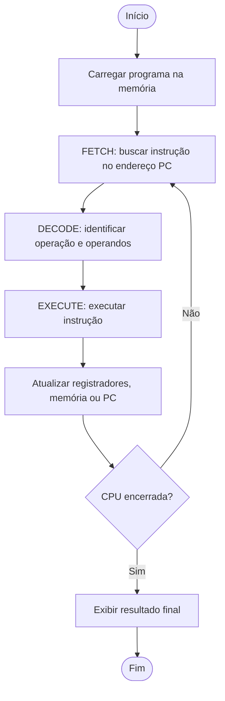

<div align="center">

# 💻 CPU Simulada — 8 Bits

### Trabalho de Arquitetura e Organização de Computadores · AOC 2026.2

[](https://www.python.org/)
[](#-especificações-da-cpu)
[](#-objetivo)

**Implementação didática de uma CPU de 8 bits em Python**, com registradores, memória, ULA, instruções e execução passo a passo.

</div>

---

## 📌 Objetivo

Este projeto simula o funcionamento básico de um processador para estudar os conceitos de **Arquitetura e Organização de Computadores**. A CPU interpreta instruções armazenadas na memória, executa operações aritméticas e lógicas e apresenta a evolução do seu estado a cada ciclo.

O ciclo de instrução é organizado conceitualmente em três etapas:

1. **Fetch (Busca):** busca a instrução apontada pelo contador de programa (`PC`).
2. **Decode (Decodificação):** identifica a operação e seus operandos.
3. **Execute (Execução):** executa a instrução e atualiza os registradores, a memória ou o `PC`.

## 🧰 Tecnologias utilizadas

<div align="center">

| Tecnologia | Utilização |
|:--|:--|
|  | Linguagem de implementação |
|  | Controle de versão, caso utilizado no repositório |
|  | Documentação do projeto |

</div>

> O projeto utiliza apenas recursos padrão do Python, sem dependências externas conhecidas para a execução básica.

## ⚙️ Especificações da CPU

| Componente | Especificação |
|:--|:--|
| Largura dos dados | 8 bits (valores de 0 a 255) |
| Registradores gerais | `R0`, `R1`, `R2` e `R3` |
| Memória | 16 posições, endereços de 0 a 15 |
| Contador de programa | `PC` (*Program Counter*) |
| Unidade lógica e aritmética | ULA com operações aritméticas e lógicas |
| Controle de execução | Ciclos de busca, decodificação e execução |
| Encerramento | Instrução `HALT` |

Os resultados são limitados a 8 bits. Portanto, operações que ultrapassam o intervalo de 0 a 255 são ajustadas para esse intervalo usando os 8 bits menos significativos.

## 🧠 Instruções implementadas

| Instrução | Funcionamento |
|:--|:--|
| `LOAD R0, valor` | Carrega um valor imediato em um registrador. |
| `STORE R0, endereço` | Armazena o valor de um registrador em uma posição da memória. |
| `ADD R0, R1` | Soma `R0` e `R1`, guardando o resultado em `R0`. |
| `SUB R0, R1` | Subtrai `R1` de `R0`, guardando o resultado em `R0`. |
| `AND R0, R1` | Executa AND bit a bit. |
| `OR R0, R1` | Executa OR bit a bit. |
| `XOR R0, R1` | Executa XOR bit a bit. |
| `JMP endereço` | Altera o `PC` para o endereço indicado. |
| `HALT` | Interrompe a execução da CPU. |

Nos exemplos acima, `R0` e `R1` são operandos ilustrativos; as operações da ULA usam os registradores definidos na instrução.

## 🗂️ Organização dos arquivos

```text
CPU_SIMULADA/
├── cpu.py          # Estrutura da CPU e execução das instruções
├── ula.py          # Operações aritméticas e lógicas da ULA
├── programas.py    # Programas utilizados na demonstração e nos testes
├── testes.py       # Testes automatizados
├── main.py         # Ponto de entrada: executa o programa autoral
└── README.md       # Documentação do projeto
```

### Responsabilidade de cada arquivo

- **`cpu.py`**: mantém os registradores, a memória, o contador de programa e o estado de execução; interpreta e executa as instruções.
- **`ula.py`**: implementa `ADD`, `SUB`, `AND`, `OR` e `XOR`, além da limitação dos resultados a 8 bits.
- **`programas.py`**: reúne as sequências de instruções, incluindo o programa autoral.
- **`testes.py`**: verifica o comportamento das instruções e os resultados esperados.
- **`main.py`**: carrega o programa autoral na memória, inicia a CPU e exibe o resultado final.

## 🔄 Visão geral do funcionamento



## ▶️ Como executar

### 1. Pré-requisitos

- Python 3 instalado.
- Os arquivos do projeto na mesma pasta.

Confira a instalação no terminal:

```bash
python --version
```

Em alguns ambientes, o comando pode ser `python3` em vez de `python`.

### 2. Executar o programa autoral

Abra o terminal na pasta do projeto e execute:

```bash
python main.py
```

A execução apresenta, a cada ciclo, o endereço indicado pelo `PC`, a instrução buscada e os valores dos registradores. Ao final, são mostrados os registradores e as posições de memória utilizadas pelo programa.

### 3. Executar os testes automatizados

```bash
python testes.py
```

Os testes devem terminar sem erros e indicar que os casos verificados foram aprovados. Se algum teste falhar, confira a mensagem apresentada e o código da instrução correspondente.

## 🧪 Programa autoral

O programa autoral utiliza nove instruções para somar dois valores, armazenar a soma, executar uma operação XOR e subtrair o resultado dessa operação.

```text
Endereço  Instrução
-------   ----------------
0         LOAD R0, 12
1         LOAD R1, 10
2         ADD R0, R1
3         STORE R0, 14
4         LOAD R2, 12
5         XOR R1, R2
6         SUB R0, R1
7         STORE R0, 15
8         HALT
```

### Explicação do cálculo

1. `R0` recebe `12` e `R1` recebe `10`.
2. `ADD R0, R1` calcula `12 + 10 = 22`; o resultado fica em `R0`.
3. `STORE R0, 14` salva a soma na posição 14 da memória.
4. `R2` recebe `12`.
5. `XOR R1, R2` calcula `10 XOR 12 = 6`; o resultado fica em `R1`.
6. `SUB R0, R1` calcula `22 - 6 = 16`; o resultado fica em `R0`.
7. `STORE R0, 15` salva o resultado final na posição 15 da memória.
8. `HALT` encerra a execução.

### Resultado final esperado

```text
R0 = 10 (16 decimal)
R1 = 06 (6 decimal)
R2 = 0C (12 decimal)
R3 = 00 (0 decimal)

Memória[14] = 22   # resultado da soma
Memória[15] = 16   # resultado final: soma - XOR
```

A saída do programa pode exibir os registradores em hexadecimal e decimal ao mesmo tempo. Por exemplo, `R0 = 10 (16)` significa hexadecimal `10`, que corresponde a decimal `16`.

## ✅ Testes importantes

O projeto deve ser validado, no mínimo, para os seguintes comportamentos:

- `LOAD`: carregar um valor em um registrador.
- `STORE`: gravar o conteúdo de um registrador na memória.
- `ADD` e `SUB`: calcular soma e subtração.
- `AND`, `OR` e `XOR`: produzir os resultados bit a bit esperados.
- Avanço do `PC` após uma instrução comum.
- `JMP`: saltar para o endereço indicado e ignorar instruções no caminho.
- `HALT`: interromper a execução.
- Limitação de resultados a 8 bits.
- Programa autoral: confirmar a soma em `Memória[14]` e o resultado final em `Memória[15]`.

## 📚 Conceitos demonstrados

- Organização de uma CPU simplificada.
- Registradores e memória.
- Contador de programa (`PC`).
- Representação de dados em 8 bits.
- Operações aritméticas e lógicas bit a bit.
- Busca, decodificação e execução de instruções.
- Desvios de fluxo com `JMP`.
- Testes automatizados de software.

## 👥 Contexto acadêmico

Projeto desenvolvido para a disciplina de **Arquitetura e Organização de Computadores (AOC)**, semestre **2026.2**.

---

<div align="center">

Feito para fins didáticos — CPU Simulada de 8 Bits

</div>
